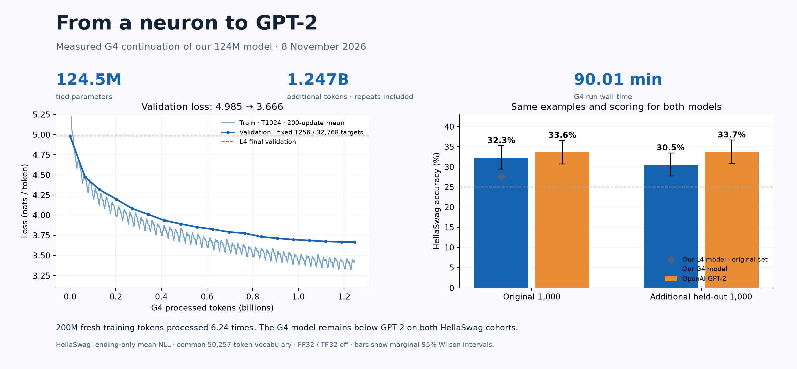

# neuron-to-gpt

A learning journal that starts with a single neuron, moves through
character-level language models, and builds toward the core ideas behind GPT.
Each week has its own directory with runnable Python files and concept notes.

[Results](#measured-results) · [Curriculum](#weeks) · [Setup](#setup) · [G4 evidence](#g4-continuation-experiment)

**Final experiment:** our own 124M GPT-2 checkpoint was continued on an NVIDIA
RTX PRO 6000 Blackwell GPU for 90 minutes. Validation loss fell from **4.985 to
3.666**; HellaSwag accuracy on the original 1,000 examples improved from **27.6%
to 32.3%**. The matching OpenAI GPT-2 reference scored **33.6%** and remained
ahead on a separate held-out cohort as well.



## Measured results

| Evaluation | Our L4 checkpoint | Our G4 continuation | OpenAI GPT-2 |
|---|---:|---:|---:|
| FineWeb validation NLL, fixed 32,768 targets | 4.984965 | **3.665616** | Not measured |
| HellaSwag, original validation indices 0–999 | 276/1,000 · 27.6% | **323/1,000 · 32.3%** | 336/1,000 · 33.6% |
| HellaSwag, additional held-out indices 1,000–1,999 | Not measured | **305/1,000 · 30.5%** | 337/1,000 · 33.7% |

The G4 run processed **1,247,182,848 additional tokens** in **90.01 minutes**,
with **38,061 successful updates**. Including the earlier L4 run, the model saw
**1,327,407,104 tokens**. The G4 corpus contains **200M fresh tokens**, processed
about **6.24 times**; processed tokens are not unique data. Throughput over the
G4 run wall time was **230,933 token/s**.

The model has **12 blocks, 12 heads, width 768, and 1,024 positions**. Its tied
embedding/output table is padded to 50,304 entries, giving **124,475,904 unique
parameters**. GPT-2 tokenization uses 50,257 IDs; padding classes are excluded
from sampling and HellaSwag scoring. Week 10 imports OpenAI weights to verify
the implementation; Week 12 starts from random weights and G4 continues that
trained checkpoint. OpenAI GPT-2 is a separate evaluation reference.

Both models use the same HellaSwag examples, ending-only mean token NLL,
the common 50,257-token vocabulary, FP32 and TF32 disabled. The G4 checkpoint
was selected by validation loss; the additional 1,000 examples were reserved for
the pilot comparison. This result does not establish general model parity.
Training context, batch, data and hardware differ between L4 and G4, so their
throughputs are not a controlled hardware speed comparison.

- [G4 experiment report — Türkçe](experiments/g4/results/nvidia_rtx_pro6000/report.md)
- [G4 raw records, predictions and runtime sources](experiments/g4/results/nvidia_rtx_pro6000/)
- [G4 training guide and notebook](experiments/g4/README.md)
- [Original L4 training report](week12/results/nvidia_l4/submission_report.md)

## Learning path

The first two weeks build derivatives, gradient descent, and backpropagation
without machine-learning libraries. Week 3 moves to PyTorch to show how the
previously implemented `backward()` mechanism scales from scalar values to
tensors.

Weeks 1–4 retain their original filenames for backward compatibility. New
Week 5–10 files and commands use English naming consistently.

## Setup

```bash
git clone https://github.com/muend/neuron-to-gpt
cd neuron-to-gpt
python3 --version
```

Weeks 1–2 use only the standard library. For Weeks 3–7:

```bash
pip install -r week03/requirements.txt
```

## Weeks

| Week | Topic | Status |
|------|-------|--------|
| [01](week01/) | Neurons, layers, loss, gradient descent, and the language-model idea | ✅ |
| [02](week02/) | Backpropagation: `Value`, computation graphs, `backward()`, and MLP training | ✅ |
| [03](week03/) | Bigram character LM: counts, probabilities, sampling, NLL, softmax, and autograd | ✅ |
| [04](week04/) | Embeddings, MLP character LM, initialization, tanh saturation, and BatchNorm | ✅ |
| [05](week05/) | Expanded MLP + BatchNorm graph, broadcasting, and manual backpropagation | ✅ |
| [06](week06/) | Custom layer classes, eight-character context, and a WaveNet-style hierarchy | ✅ |
| [07](week07/) | Tiny Shakespeare, character batches, causal averages and single-head self-attention | ✅ |
| [08](week08/) | Multi-head attention, Transformer blocks, character GPT, A100 training and a Gradio model lab | ✅ |
| [09](week09/) | Byte-level BPE, Unicode/UTF-8, regex pretokenization and cl100k_base compatibility | ✅ |
| [10](week10/) | GPT-2 124M, pretrained weight import, logits parity, sampling and a fixed-batch training diagnostic | ✅ |
| [11](week11/) | GPT-2 training speed, optimizer/schedule and gradient accumulation | ✅ L4: six measured stages, 300 updates |
| [12](week12/) | FineWeb-Edu shards, held-out validation, timed training and matching HellaSwag evaluations | ✅ L4: 19,586 updates; HellaSwag 27.6% vs GPT-2 33.6% |
| [G4 pilot](experiments/g4/) | 90-minute continuation, fresh data, verified checkpoint resume and paired evaluations | ✅ 38,061 updates; held-out HellaSwag 30.5% vs GPT-2 33.7% |

## Run Week 1

```bash
cd week01
python3 adim1_tek_noron.py
python3 adim2_katman.py
python3 adim3_loss.py
python3 adim4_loss_egrisi.py
python3 adim5_gradient_descent.py
python3 bonus_bigram_lm.py
```

See [week01/README.md](week01/README.md) for details.

## Run Week 2

```bash
cd week02
python3 adim1_value.py
python3 adim2_elle_gradient.py
python3 adim3_backward.py
python3 adim4_dogrulama.py
python3 adim5_mlp.py
```

See [week02/README.md](week02/README.md) for details.

## Run Week 3

```bash
cd week03
python veri_hazirla.py
python adim1_2_3_bigram_count.py
python adim4_bigram_nn.py
python adim5_turkce.py
python bonus_trigram.py --dataset en
```

See [week03/README.md](week03/README.md) for details.

## Run Week 4

```bash
python week04/adim1_mlp.py
python week04/adim2_init_batchnorm.py
python week04/adim3_turkce.py
python week04/bonus_batchnorm_fold.py
```

See [week04/README.md](week04/README.md) for details.

## Run Week 5

```bash
python week05/step1_autograd_reference.py
python week05/step2_manual_backprop.py
```

See [week05/README.md](week05/README.md) for details.

## Run Week 6

```bash
python week06/test_layers.py
python week06/run_experiments.py
```

See [week06/README.md](week06/README.md) for the model shapes and recorded results.

## Run Week 7

```bash
python week07/data.py
python week07/step2_attention_math.py
python week07/test_attention.py
python week07/run_experiments.py
python week07/step3_inspect_attention.py
```

See [week07/README.md](week07/README.md) for attention weights, scaling examples
and measured bigram/attention validation losses.

## Run Week 8

```bash
python week08/prepare_data.py --english-only
python week08/test_gpt.py
python week08/inspect_model.py
```

See [week08/README.md](week08/README.md) for the six-stage measured comparison,
user-selected Nazim Hikmet data preparation and the Colab GPU training notebook.
Both larger models completed 5,000 updates on an A100 in Colab. Final validation
NLL is 1.4723 for Shakespeare and 1.6239 for the selected Turkish collection;
these cross-language losses are not a direct quality ranking. Reviewed metrics,
loss plots and generated samples are in [week08/results/gpu](week08/results/gpu).
The optional [Gradio model lab](week08/PANEL.md) displays this evidence and enables
live generation when the owner's matching model checkpoints are connected.

## Run Week 9

```powershell
python -m venv week09/.venv
.\week09\.venv\Scripts\python.exe -m pip install -r week09/requirements.txt
.\week09\.venv\Scripts\python.exe -m unittest discover -s week09 -p "test_*.py"
.\week09\.venv\Scripts\python.exe week09/run_experiments.py
```

See [week09/README.md](week09/README.md) for setup and
[the Turkish submission report](week09/results/submission_report.md) for measured
compression, first merges, language comparison and exact `cl100k_base` token IDs.
The experiment uses the private Week 8 corpus by default; `--corpus` accepts your
own UTF-8 text. Tokenizer training and inference run on CPU without a model API.

## Run Week 10

Open [week10/colab_gpt2.ipynb](week10/colab_gpt2.ipynb) in Colab and run its
numbered cells on T4 and A100. It embeds the verified project sources, checks
Hugging Face logits in FP32, samples English/Turkish text and trains a fresh
124M model for 300 updates on one batch. No private corpus or Drive mount is
needed. Download each result ZIP before changing the runtime.

See [week10/README.md](week10/README.md) for local checks and import commands,
and [the Turkish submission report](week10/results/submission_report.md) for
the measured results, position-embedding plots and the limits of these tests.

## Run Week 11

Open [week11/colab_training.ipynb](week11/colab_training.ipynb) in Colab on a
T4 or A100. It benchmarks cumulative speed optimizations and runs 300 training
update attempts using our Week 10 model, AdamW, clipping, warmup/cosine LR and
gradient accumulation. Download the result ZIP before changing the runtime.
See [week11/README.md](week11/README.md) for checks and the verified L4 results.

## Run Week 12

Use [week12/colab_training.ipynb](week12/colab_training.ipynb), or paste the
[bootstrap](week12/colab_bootstrap.py) into a new cell in the connected Week 11
notebook to retain its L4 runtime. Prepare 20M train tokens and a disjoint
validation file, train for a 60-minute wall budget, then evaluate the trained
checkpoint and published GPT-2 on the same first 1,000 HellaSwag examples.
The completed L4 run processed 80,224,256 tokens in 60.20 minutes; final held-out
NLL was 4.984965. On the same first 1,000 HellaSwag validation examples our
checkpoint scored 27.6% and OpenAI GPT-2 33.6%. See the
[GPU report](week12/results/nvidia_l4/submission_report.md) and
[week12/README.md](week12/README.md) for scoring, source provenance and limits.

## G4 continuation experiment

The [G4 notebook](https://colab.research.google.com/github/muend/neuron-to-gpt/blob/main/experiments/g4/colab_pilot.ipynb)
continues the specific verified L4 checkpoint on fresh FineWeb-Edu data. It
requires the owner's backed-up checkpoint and token archive and verifies that
checkpoint's hash. A fresh clone includes the evidence rather than trained
weights or token shards. The recorded G4 environment was **PyTorch 2.14.1+cu130,
CUDA 13.0, Python 3.13.16**; requirements use version ranges, not a locked environment.

The final run uses B=8, T=1024, accumulation=4 (32,768 tokens/update), BF16,
SDPA, torch.compile and fused AdamW. The total budget is 90 minutes across G4
sessions. It includes loading, compilation, validation and periodic IO; data
preparation, paused downtime and final evaluation are outside that budget.
Exact settings and resume history are in the recorded `training.json`.

### Verify the published evidence

```bash
python -m pip install -r week12/requirements.txt
python experiments/g4/analyze_results.py --check
```

This check needs no GPU, checkpoint, dataset download or model API. Omit
`--check` to regenerate the analysis, report and figure. Implementation checks:

```bash
python -m unittest discover -s week10 -p "test_*.py"
python -m unittest discover -s week11 -p "test_*.py"
python -m unittest discover -s week12 -p "test_*.py"
python -m unittest experiments.g4.test_pilot
```

The published G4 evidence contains all 38,061 update rows, 19 validation checks,
generated samples, per-example scores for four HellaSwag evaluations, source
snapshots, and file/checkpoint hashes. Local verification checks exported bytes,
token/update accounting and predictions reconstructed from saved NLL scores.
Colab separately verified the token shards and their Drive copies, plus both
checkpoint backups. **GPU inference was not independently rerun locally.**

Checkpoint files, token arrays, raw corpora, caches, virtual environments,
correspondence and local transport bundles are excluded from Git. Data manifests
contain document/shard hashes and metadata, not source text. Benchmark questions
are fetched from the pinned source rather than copied into the repository.
This is a base language-model study, not a chat assistant or production service;
generated text can repeat itself or lose coherence. Confidence intervals and
paired comparisons are documented in the [G4 report](experiments/g4/results/nvidia_rtx_pro6000/report.md).

## Sources

- 3Blue1Brown — [But what is a neural network?](https://www.youtube.com/watch?v=aircAruvnKk)
- 3Blue1Brown — [Gradient descent, how neural networks learn](https://www.youtube.com/watch?v=IHZwWFHWa-w)
- Andrej Karpathy — [The spelled-out intro to neural networks](https://www.youtube.com/watch?v=VMj-3S1tku0)
- Andrej Karpathy — [micrograd](https://github.com/karpathy/micrograd)
- Andrej Karpathy — [The spelled-out intro to language modeling: building makemore](https://www.youtube.com/watch?v=PaCmpygFfXo)
- Andrej Karpathy — [makemore](https://github.com/karpathy/makemore)
- Andrej Karpathy — [Building makemore Part 2: MLP](https://www.youtube.com/watch?v=TCH_1BHY58I)
- Andrej Karpathy — [Building makemore Part 3: Activations & Gradients, BatchNorm](https://www.youtube.com/watch?v=P6sfmUTpUmc)
- Andrej Karpathy — [Building makemore Part 4: Becoming a Backprop Ninja](https://www.youtube.com/watch?v=q8SA3rM6ckI)
- Andrej Karpathy — [Building makemore Part 5: Building a WaveNet](https://www.youtube.com/watch?v=t3YJ5hKiMQ0)
- Andrej Karpathy — [Let's build GPT](https://www.youtube.com/watch?v=kCc8FmEb1nY)
- Bengio et al. — [A Neural Probabilistic Language Model](https://www.jmlr.org/papers/volume3/bengio03a/bengio03a.pdf)
- PyTorch — [Broadcasting semantics](https://pytorch.org/docs/stable/notes/broadcasting.html)
- Andrej Karpathy — [Let's reproduce GPT-2](https://www.youtube.com/watch?v=l8pRSuU81PU), [build-nanogpt](https://github.com/karpathy/build-nanogpt)
- Brown et al. — [Language Models are Few-Shot Learners](https://arxiv.org/abs/2005.14165)
- [FineWeb-Edu](https://huggingface.co/datasets/HuggingFaceFW/fineweb-edu), [HellaSwag](https://arxiv.org/abs/1905.07830), [evaluation dataset](https://huggingface.co/datasets/Rowan/hellaswag)
