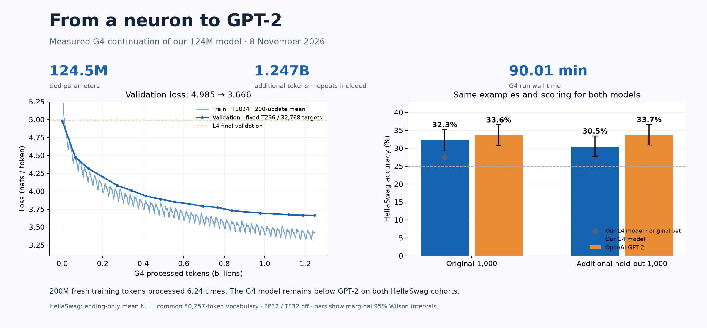

# G4: 90-minute GPT-2 continuation pilot

Continue our verified 124M L4 checkpoint, retaining AdamW moments. This is an
experiment separate from the Week 11/12 results. The completed run and its
byte-verified source snapshots are in [results/nvidia_rtx_pro6000](results/nvidia_rtx_pro6000/).
See `colab_pilot.ipynb` for sequential cells.

## Completed run

| Metric | Recorded result |
|---|---:|
| Model | 124,475,904 parameters; same architecture as the L4 checkpoint |
| Successful G4 updates | 38,061 |
| Additional processed tokens | 1,247,182,848; repeats included |
| Fresh training corpus | 200M tokens, processed 6.2359 times |
| G4 run wall time | 90.0104 minutes |
| Wall / optimizer throughput | 230,933 / 236,812 token/s |
| Fixed validation NLL | 4.984965 → 3.665616 |
| Original HellaSwag 1,000 | Own 32.3%; GPT-2 33.6% |
| Additional held-out 1,000 | Own 30.5%; GPT-2 33.7% |

The model remains below the GPT-2 reference on both cohorts. L4 scored 27.6%
on the original cohort, so continuation improved that score by 4.7 percentage
points. The [report](results/nvidia_rtx_pro6000/report.md) documents the protocol,
uncertainty, samples and checkpoint/data provenance.



## Training and evaluation protocol

The pilot uses BF16, PyTorch SDPA, fused AdamW, gradient clipping at 1,
`torch.compile`, context 1024 and a 32,768-token effective batch (B8, accumulation
4). These are practical starting settings, not a measured optimum for every G4
configuration. Per-update timings include synchronization; first compilation
appears in the first update. All updates are appended to `updates.jsonl`;
`training.json` retains sampled updates, validation checks and text samples.

Fresh FineWeb-Edu data excludes the exact document hashes of **both** original
training and validation splits. It requests 200M tokens with a 4-minute preparation
budget; the manifest records the actual size. Network startup/reads can exceed
this preparation budget. Data may repeat if training consumes more tokens than
the prepared corpus. This is exact document deduplication, not benchmark or
near-duplicate decontamination.

Validation keeps the original shard and B4/T256/32-batch protocol (32,768 target
tokens), allowing comparison with the L4 loss 4.984965. Training context changes
to 1024; positions beyond 256 had little prior training. Validation is used to
select `best.pt`, including the initial checkpoint if no improvement occurs.
`last.pt` retains optimizer, loader and RNG state. `train --resume <G4 last.pt>`
continues in the same output directory with unchanged data/model/batch settings.
`--minutes 90` means **90 minutes total across G4 sessions**, not 90 additional
minutes. There is no delivery-time cutoff in the notebook. A user-requested
budget extension changes the remaining cosine envelope and records the prior
budget, deadline, checkpoint hash and source hashes. Only the pilot controller
source may migrate; core model/training/data sources must match.

For a BF16/zero-dropout interruption, all AdamW tensor step counters must agree.
The loader rewinds any uncommitted microbatches so that the next update uses
the next unseen batch of the committed optimizer state. A disagreement fails
closed. Historical update logs may have a gap if interruption occurred after
the optimizer committed and before the logging write; it is not filled with
fabricated loss values. Restore both `last.pt` and `best.pt` when moving runtimes.
Periodic backups go to a separate Drive directory. The CLI does not overwrite
an existing local run or use the baseline checkpoint folder as its backup.

The LR warms up over 30 successful updates, with a wall-time cosine envelope
from 3e-4 to 3e-5. The **90-minute budget includes model loading, initial
validation, compilation and periodic IO**; interrupted downtime is excluded.
An optional explicit `--deadline` can shorten that budget. An in-flight update,
final validation and final checkpoint/Drive
copy can finish after it; leave at least 10–12 minutes for final evaluation and IO.
This timing is a cap on starting updates, not a guarantee about external services.

`finish` evaluates validation-selected weights and pinned OpenAI GPT-2 in FP32,
TF32 off, on identical examples and the common 50,257-token vocabulary. It
reports the original first 1,000 HellaSwag examples for course continuity and
the **next 1,000** as the primary pilot comparison. Do not tune this pilot on
the latter selection. Wilson intervals are recorded in evaluation JSONs. A
single point-estimate lead does not establish that the model is generally better.
Evaluation JSONs live under `evaluations/<checkpoint-and-source-id>` so a later
resumed run preserves earlier scores rather than reusing a different model's cache.

Source/data/checkpoint hashes, extra tokens and total tokens including the L4
run are recorded. The checkpoint must have the verified L4 SHA-256. Outputs,
token shards and weights are ignored by Git; small verified results can be
published separately after reviewing an actual run.

## Verification and evidence

`runtime_verification.json` records the Colab checks of all 201 token shards,
both Drive checkpoint copies and saved evaluation predictions. The published
source snapshots and raw results are preserved byte-for-byte by `.gitattributes`.
Local verification does not rerun model inference or require private weights:

```bash
python experiments/g4/analyze_results.py --check
python experiments/g4/analyze_results.py
```

The second command regenerates `analysis.json`, `report.md` and `overview.png`.
Benchmark question text is not republished; dataset revision and cohort hashes
are recorded in `selection_manifest.json`. The 38,061 per-update records and
all four sets of per-example scores are included. Trained weights and token
shards stay in the private Drive backup, including `tokens/manifest.json` and
the 201 verified NPY shards needed for an exact data restore.

Implementation checks:

```powershell
.\week10\.venv\Scripts\python.exe -m unittest experiments.g4.test_pilot
.\week10\.venv\Scripts\python.exe -m unittest discover -s week12 -p 'test_*.py'
```
