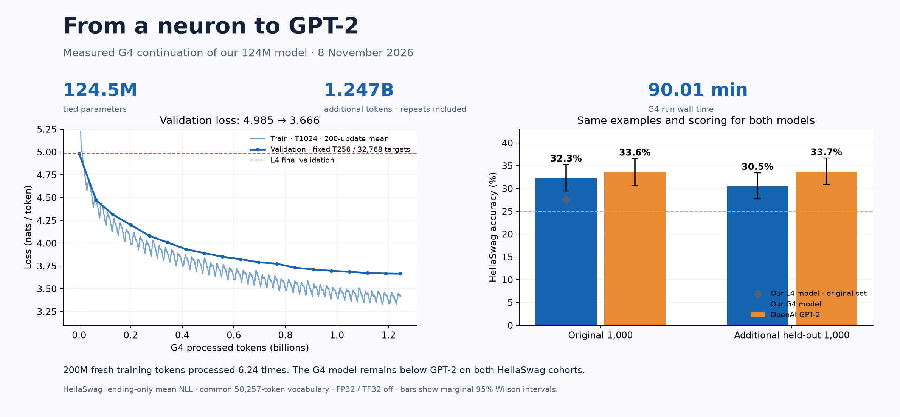

# G4 devam eğitimi — ölçülmüş sonuçlar

8 Kasım 2026 · NVIDIA RTX PRO 6000 Blackwell Server Edition

Kendi L4 checkpoint'imizden devam eden 90 dakikalık deney tamamlandı. Model, OpenAI GPT-2 ağırlıklarından başlatılmadı. Validation loss ve ilk HellaSwag grubundaki başarı iyileşti; iki değerlendirme grubunda da GPT-2'nin puanının altında kaldı.



## Eğitim

| Ölçüm | Değer |
|---|---:|
| Parametre | 124.475.904; weight tying, vocab 50.304 |
| Yapı | 12 blok, 12 head, genişlik 768; pozisyon tablosu 1.024 |
| Başarılı G4 güncellemesi | 38,061 |
| G4 işlenen token | 1,247,182,848 |
| L4 dahil toplam token | 1,327,407,104 |
| Yeni eğitim havuzu | 200.000.000 token |
| Yeni havuzun işlenme miktarı | 6.2359 tur; token tekrarları dahil |
| G4 duvar süresi | 90.0104 dakika |
| Güncelleme sürelerine göre hız | 236,811.8 token/s |
| Toplam duvar süresine göre hız | 230,933.1 token/s |
| L4 son / G4 son validation loss | 4.984965 → 3.665616 |

B=8, T=1024, accumulation=4; etkin batch 32.768 token. BF16, SDPA, torch.compile ve fused AdamW kullanıldı. AdamW β=(0.9,0.95), ε=1e-8, matrislerde decay=0.1 ve clipping=1.0. LR 30 başarılı güncellemede ısınır; duvar zamanına bağlı cosine zarfı 3e-4'ten 3e-5'e iner.

Süre; yükleme, ilk derleme, validation ve dönemsel kayıtları içerir. Kesinti arasında geçen süre, veri hazırlığı ve son HellaSwag testi bu bütçeye dahil değildir. Yaklaşık 9,57 dakikada bir kez devam kaydı açıldı; eski saat sınırı kaldırılıp toplam bütçe 90 dakikaya uzatıldı. 3.989 tamamlanmış güncelleme korundu, 16.384 tamamlanmamış mikro-batch token'ı yeniden okundu. Kaynak sürümü, eski/yeni süre ayarı ve checkpoint hash'i training.json içindeki resumes alanında kayıtlıdır.

## Veri ve validation

FineWeb-Edu sample-10BT'nin sabit revizyonu kullanıldı. Yeni train belgelerinden hem eski L4 train hem de val belgelerinin birebir SHA-256 eşleşmeleri çıkarıldı. Bu, yakın kopya veya benchmark sızıntısı temizliği yapıldığı anlamına gelmez.

Eski 131.072-token validation shard'ı byte düzeyinde korundu. Her kontrolde B=4, T=256 ile aynı ilk 32.768 hedef token ölçüldü. Son ve en iyi checkpoint 38.061. güncellemedir. Train loss T1024'te ve farklı eğitim metninde ölçülür; train/val çizgileri aynı veri ve context koşullarının ölçümü değildir. OpenAI GPT-2 için bu FineWeb validation loss'u ölçülmedi.

## HellaSwag

İlk 1.000 örnek önceki deneyle devamlılık içindir; sonraki 1.000 örnek pilotun önceden ayrılmış ana karşılaştırmasıdır. Checkpoint seçimi validation loss'una göre yapıldı. İki model aynı örnekleri, completion-only ortalama token NLL, ortak 50.257-token vocabulary, FP32 ve TF32 kapalı ayarlarıyla değerlendirdi.

| Grup | Kendi G4 modelimiz | OpenAI GPT-2 | Fark (kendi − GPT-2) |
|---|---:|---:|---:|
| İlk 1.000 | 323/1000 = %32.3 | 336/1000 = %33.6 | -1.3 yüzde puan |
| Sonraki ayrı 1.000 | 305/1000 = %30.5 | 337/1000 = %33.7 | -3.2 yüzde puan |

L4 checkpoint'i ilk grupta %27,6 almıştı: G4 devam eğitiminin aynı gruptaki artışı **4,7 yüzde puan**. Bu sonuç bir test grubundaki puan farkıdır; genel kodlama, sohbet veya muhakeme yeteneğinde denkliğe çevrilemez.

Eşleştirilmiş karşılaştırma (aynı örnekteki doğruluk sonuçları birlikte yeniden örneklendi):

| Grup | Yalnız kendi doğru | Yalnız GPT-2 doğru | Fark için paired bootstrap %95 aralığı |
|---|---:|---:|---:|
| İlk 1.000 | 88 | 101 | [-4.00, +1.40] yüzde puan |
| Ayrı 1.000 | 58 | 90 | [-5.60, -0.80] yüzde puan |

Bootstrap 20.000 tekrar, seed=20261108; örnekler arası bağımsızlık varsayımıyla yaklaşık bir belirsizlik ölçüsüdür. Her modelin Wilson aralığı ve exact McNemar p değeri analysis.json dosyasındadır; bunlar modelin her görevde daha iyi/kötü olduğunu kanıtlamaz.

## Üretilen metin

Aynı prompt: `The children walked into the`. Seed=42, temperature=0.8, top-k=50; en fazla 48 yeni token.

### G4 başlangıcı

> The children walked into the way, which is called the “Kak,” they take into account their own needs and can be taught in the form of “Rarm,” as they turn their way around and go through the “W

### G4 sonu

> The children walked into the school and enjoyed the music. As the summer started to get underway, the teacher was amazed at the new songs. A young man was still amazed by the songs.
> The children continued to enjoy singing “My Name is a My Heart

Cümle yapısı daha düzenli görünse de tekrarlar ve anlam sorunları sürüyor. Son metin 48-token üretim sınırında kesilir; bu örnek tek başına kapsamlı kalite değerlendirmesi değildir.

## Kanıt ve yeniden üretim

- `updates.jsonl`: 38.061 güncellemenin loss, norm, LR, süre ve token/s kayıtları.
- `training.json`: örneklenmiş history, 19 validation kontrolü, örnek metinler, optimizer ayarları ve resume geçmişi.
- `data_manifest.json`: belge hash'leri, veri revizyonu ve shard hash'leri; kaynak metin veya token dizileri içermez.
- `evaluations/`: dört değerlendirmede örnek başına etiket, tahmin ve seçenek NLL'leri.
- `sources/`: GPU koşusunda kullanılan kaynak dosyalarının byte düzeyinde kopyaları.
- `checkpoint_manifest.json`: son/en iyi checkpoint boyutu, model ayarı ve SHA-256.
- `runtime_verification.json`: Colab'da shard ve Drive kopyası kontrolleri; inference tekrar koşulmadı.
- `export_manifest.json`: indirilen özgün dosyaların hash ve boyutları; `analysis.json` yerel tutarlılık kontrollerini içerir.

Checkpoint'ler ve 201 token shard'ı Drive'da doğrulanarak saklandı; Git'e eklenmedi. Benchmark soru metinleri de tekrar yayımlanmadı; dataset revizyonu ve seçim hash'leri selection_manifest.json içindedir. Yerelde tüm özgün dosyaların hash'leri, kaynak kopyaları, eğitim muhasebesi ve kaydedilmiş NLL'lerden argmin/doğru sayıları yeniden kontrol edildi. GPU inference yerelde tekrarlanmadı.

Repo kökünden:

```bash
python experiments/g4/analyze_results.py --check
python experiments/g4/analyze_results.py
```

G4 çalışma adımları ve checkpoint gereksinimleri için [deney README'si](../../README.md).
