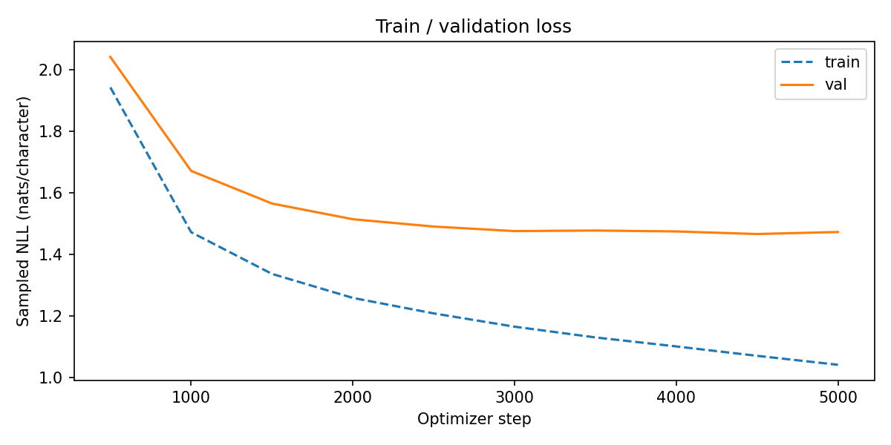
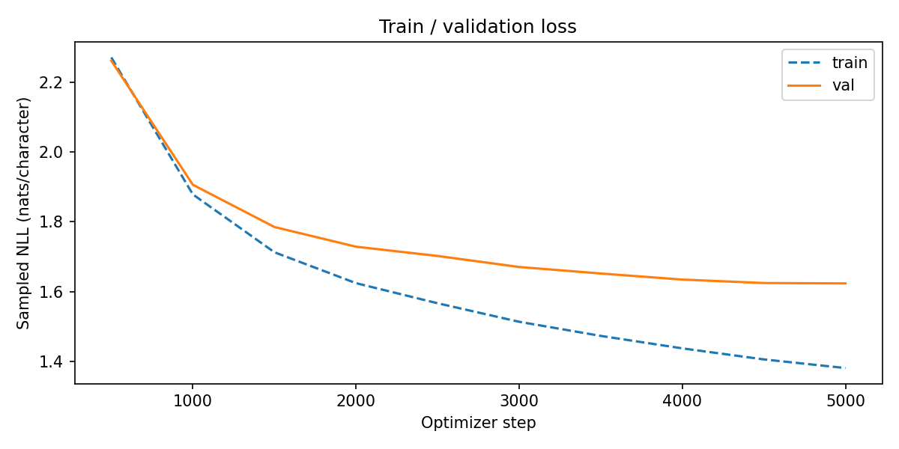

# Week 8 Character GPT

The implementation progressively adds multi-head attention, feedforward layers, residual paths and pre-LayerNorm. Six controlled English CPU experiments are measured below. Both larger models completed 5,000 optimizer updates on an NVIDIA A100-SXM4-40GB in Colab. The returned export was checked against its histories, model parameter counts and the exact local training corpora; see [validation notes](results/gpu/validation.md).

## Controlled architecture comparison

All stages use the same Shakespeare corpus, contiguous 90/10 train/validation split, seed 1337, 4,000 training iterations, batch/context size 32, embedding width 64, AdamW learning rate 0.003 and gradient clipping at 1. Validation uses the same 200 sampled batches per stage in FP32. Dropout is disabled here; only the completed model has LayerNorm. The first two implementations are reused from `week07` and reproduce its recorded losses. The increasing parameter counts mean this is not a parameter-matched ablation.

| Stage | Parameters | Final validation NLL | Training seconds |
|---|---:|---:|---:|
| Bigram | 4,225 | 2.4942 | 4.58 |
| Single head | 22,721 | 2.3457 | 19.29 |
| Multi-head | 26,881 | 2.1314 | 38.98 |
| Feedforward added | 59,969 | 1.9422 | 54.91 |
| Residual added | 59,969 | 1.8846 | 45.06 |
| LayerNorm added | 60,353 | 1.8673 | 49.09 |

Numbers come from `results/cpu_ablations.csv` and the accompanying JSON files. Training seconds exclude validation, checkpoint I/O and generation; CPU timing is not a GPU speed estimate. The combined changes reduce validation NLL by 0.6269 nats/character relative to bigram. Each step improved in this particular run; improvement is not guaranteed for every configuration.

Multi-head attention splits the embedding width across heads and concatenates their outputs before a projection. Attention communicates across earlier tokens; the feedforward network acts independently at each token. Residual paths provide an identity route for activations and gradients. Pre-LayerNorm stabilizes the input to each branch before adding its output to the residual stream. Generation crops the input to `block_size` because position embeddings and the causal mask have a fixed context capacity.

## LayerNorm versus Week 6 BatchNorm

For `(B,T,C)` activations, our channels-last Week 6 BatchNorm reduces `(0,1)` and tracks channel statistics across batches for inference. LayerNorm reduces the last axis `C` separately for each token. It never mixes future tokens or unrelated examples into its statistics, and computes the same normalization in training and inference. It does not need `running_mean` or `running_var`. Both can learn scale and shift, but normalize different populations.

## Larger models and hardware choices

| Preset | Embedding | Heads | Blocks | Context | Dropout | Batch | Steps |
|---|---:|---:|---:|---:|---:|---:|---:|
| T4 | 128 | 4 | 3 | 128 | 0.2 | 64 | 5,000 |
| A100 | 256 | 8 | 6 | 256 | 0.2 | 64 | 5,000 |

Both presets use learning rate 0.0003. With the 65-character Shakespeare vocabulary, T4 has 627,009 parameters and A100 has 4,833,345. The smaller model limits attention memory and compute; the larger model increases width, depth and context. These choices are modest educational configurations, not Karpathy's largest model. `benchmark.py` measures the actual GPU before training. The returned runs establish A100 completion and timing; T4 training remains untested, and the export contains no peak-memory measurement.

Dropout is applied to attention weights, the attention projection and the feedforward output, and is disabled during validation and sampling. A100 normally supports BF16; T4 uses FP16 with GradScaler. Unsupported precision settings fail explicitly. Checkpoints save model, optimizer, scaler and RNG states, corpus checksum and critical settings. A changed corpus or configuration cannot silently resume an old run.

## Completed A100 runs

Both runs use the A100 configuration above, BF16 training, seed 1337 and 200 fixed evaluation batches in FP32. Neither run skipped any of its 5,000 optimizer updates. NLL is reported in nats per character.

| Corpus | Parameters | Final train NLL | Final val NLL | Best val NLL (step) | Training seconds | Elapsed seconds |
|---|---:|---:|---:|---:|---:|---:|
| Shakespeare | 4,833,345 | 1.0412 | 1.4723 | 1.4657 (4,500) | 435.58 | 538.01 |
| Nazim Hikmet collection | 4,860,534 | 1.3817 | 1.6239 | 1.6239 (5,000) | 436.46 | 539.56 |

Training took about 7.3 minutes per model; elapsed time including validation and checkpoint I/O was about 9 minutes per model. These are not entire Colab-session times: preprocessing, benchmarking, generation, plotting and idle time are excluded. The export includes metrics, histories and samples, not checkpoints, so the GPU evaluations were not independently rerun locally.

The English validation curve largely levels off after 3,000 updates, with its best sampled result at 4,500; the final result is slightly worse while training loss keeps falling. This suggests a plateau or mild overfitting, not a demonstrated need for more updates. Its sample uses the best checkpoint. Turkish validation keeps improving through 5,000, and its sample uses that checkpoint.

The completed English CPU model had validation NLL 1.8673; the scaled GPU model reaches 1.4723. This is a combined change in width, depth, context, iteration budget, learning rate, initialization, dropout and precision, not an isolated dropout or hardware ablation. The six-stage table above remains the controlled architecture comparison.

### Loss curves and generated text





The figures were visually checked against the saved histories. They use different vertical ranges; use each to inspect its own training trajectory, not to rank the two languages.

Unedited excerpt generated by the Shakespeare model, not a quotation from Shakespeare:

```text
KING RICHARD II:
Shall I, be made to be exceeding?

QUEEN ELIZABETH:
My hard will I be?
```

Unedited excerpt generated by the Turkish model, not a quotation from Nazim Hikmet:

```text
düşmeden elimizin sesi :
"- Yalım,
ben ne olsün benim için?
Dört her yerinde gelip bir hiç yok,
böyle alıp hanımeliydi . ."
```

Both samples learn recognizable dialogue/line patterns and vocabulary, but still contain invented words, grammar errors and weak semantic continuity. A low character loss does not guarantee coherent literary writing. Full 601-character outputs: [English](results/gpu/en_a100_layernorm/sample.txt) and [Turkish](results/gpu/tr_a100_layernorm/sample.txt). Original metrics and histories remain unchanged under `results/gpu/`.

## Run and verify

Run from the repository root in a Python environment with `week08/requirements.txt` installed:

```powershell
python week08/prepare_data.py --english-only
python week08/test_gpt.py
python week08/test_results.py
python week08/inspect_model.py
python week08/run_ablations.py --device cpu
python week08/train.py --language en --preset smoke --device cpu --eval-batches 2 --eval-interval 10
```

Use a new `--output-root` for a new experiment, or `--resume` for an existing compatible run. Smoke outputs are labeled `smoke_only` and are not submission-quality model results. The tests cover all stage shapes and gradients, causal masking, independent token feedforward computation, residual identity gradients, LayerNorm axes, dropout/evaluation behavior, character roundtrip, source provenance and duplicate checks, repeatable batches and exact CPU checkpoint continuation.

## User-selected Turkish data

The owner selected three local PDFs: collected poems, stories, and Aydinlik poetry/articles. Sources are not fetched from arbitrary author websites. The extraction pipeline excludes covers, contents and publishing material; Aydinlik contributes prose rather than repeating its poetry or photographic appendix. Poetry line and stanza boundaries are retained or reconstructed geometrically. Stories and Aydinlik prose use installed Windows Turkish OCR because the original layers are broken or noisy. Invalid-character pages are quarantined and can be recovered with Turkish OCR. Exact long overlaps are audited without removing legitimate repeated verses.

PDF processing uses `pdf_requirements.txt`; Windows OCR uses `ocr_pdf_pages.ps1` under Windows PowerShell 5.1. See `data/README.md` and each local `quality_report.json`. OCR can still substitute valid letters: representative visual checks are not proof that every word is correct. The corpus is a learning dataset, not a verified critical edition.

The prepared broad collection is 2,072,197 UTF-8 bytes and 1,904,245 characters with a 118-character vocabulary, versus Shakespeare's 65. All 243 invalid-character poetry pages were recovered with Turkish OCR; none remain quarantined in the final candidate. Cross-source exact 64-word overlap counts were zero, which does not rule out shorter or OCR-variant duplicates. Larger-model Turkish parameter counts are 640,630 (T4 preset) and 4,860,534 (A100 preset). An initial 20-step smoke run checked wiring only; the completed 5,000-update A100 run above used this same corpus, verified by SHA-256.

Raw PDFs, extracted TXT files, provenance caches and checkpoints are excluded from Git. Source hashes and reported sizes describe the owner's exact local compilation. User-provided files do not imply permission to redistribute them; no full-text corpus is pushed to GitHub.

Once the selected sources are prepared:

```powershell
python week08/audit_corpus.py --source-dir week08/data/nazim_sources/cleaned
python week08/prepare_data.py --source-dir week08/data/nazim_sources/cleaned
python week08/train.py --language tr --preset smoke --device cpu --eval-batches 2 --eval-interval 10
```

English and Turkish train separately with the same selected preset and iteration budget, but different vocabularies and text distributions. Raw NLLs are not directly comparable language-quality scores: character inventory, frequencies, genre, OCR quality and held-out segments all differ. Within-language validation and generated samples are the relevant checks. The contiguous split can also create genre or period shifts in the Turkish compilation; record that limitation rather than describing it as a balanced literary benchmark.

## Colab training

Open `colab_training.ipynb` in Colab and execute numbered cells in order to reproduce or extend the completed runs. Choose the GPU, inspect its name and benchmark, authorize your own Drive mount, and start Shakespeare before Turkish if needed. Upload the private `nazim_sources_for_colab.zip` into `MyDrive/neuron-to-gpt`, or upload only the three cleaned TXT files and `sources.json` into its `nazim_sources` subfolder. Keep the run name/settings unchanged to resume. The notebook exports measured metrics, figures and samples while leaving large checkpoints and raw corpora out of the results ZIP.

The returned `week08_gpu_results.zip` was reviewed and imported with:

```powershell
python week08/import_gpu_results.py --archive "C:/Users/Excalibur/Downloads/week08_gpu_results.zip"
```

The importer accepts this two-run export format only, rejects unexpected entries and inconsistent metrics, checks local corpus hashes, and never publishes its private provenance manifest. Identical re-imports are safe; conflicting existing results are not overwritten. If the private corpora are unavailable, `--skip-local-corpus-check` explicitly records metadata-only verification. `summarize_results.py` describes the corpus metadata saved in each result, not unrelated current local files.

## References

The implementation was written before consulting the finished reference for comparison.

- [Karpathy's GPT lecture](https://www.youtube.com/watch?v=kCc8FmEb1nY), from 1:21:59 onward.
- [Reference code](https://github.com/karpathy/ng-video-lecture).
- [nanoGPT](https://github.com/karpathy/nanoGPT).
- [Tiny Shakespeare source](https://raw.githubusercontent.com/karpathy/char-rnn/master/data/tinyshakespeare/input.txt).
- [Colab resource policy](https://research.google.com/colaboratory/faq.html): paid access does not guarantee a particular GPU.
