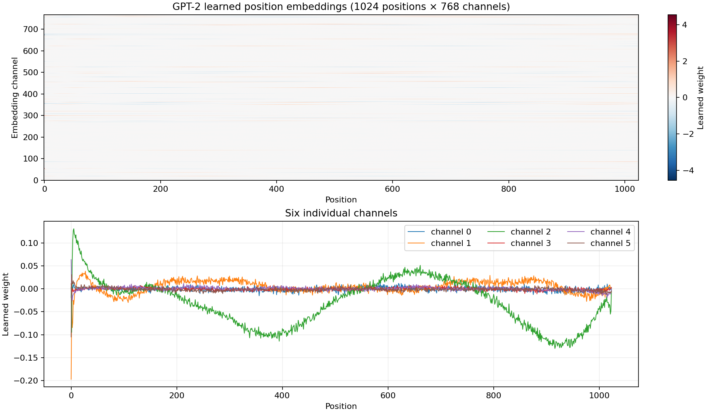
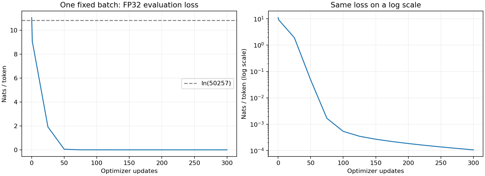

# Week 10 — GPT-2 (124M): doğrulanmış sonuçlar

Bu rapor `summarize_results.py` ile kaydedilmiş JSON, ağırlık boyutları, batch kimlikleri ve mevcut kaynak dosyaları denetlenerek oluşturuldu. Denetim yeni bir eğitim veya logits hesaplaması değildir; eksik koşular tamamlanmış sayılmaz.

## Deneylerin durumu

| Kayıt | Hazır ağırlık / logits eşleşmesi | Tam 124M tek-batch eğitimi |
|---|---|---|
| local_pretrained | [local_pretrained](local_pretrained/pretrained_metrics.json): doğrulandı | bu CPU koşusunda çalıştırılmadı |
| a100 | [a100](a100/pretrained_metrics.json): doğrulandı | [a100](a100/overfit_metrics.json): tamamlandı, ezberleme eşiği geçti |
| t4 | [t4](t4/pretrained_metrics.json): doğrulandı | [t4](t4/overfit_metrics.json): tamamlandı, ezberleme eşiği geçti |

| Hazır model koşusu | Donanım | Logits kontrolü | En büyük mutlak fark | Süre (sn) |
|---|---|---|---:|---:|
| [local_pretrained](local_pretrained/pretrained_metrics.json) | Intel64 Family 6 Model 141 Stepping 1, GenuineIntel | FP32/eager, TF32 kapalı | 0.00012207031 | 23.43 |
| [a100](a100/pretrained_metrics.json) | NVIDIA A100-SXM4-40GB | FP32/eager, TF32 kapalı | 8.392334e-05 | 10.10 |
| [t4](t4/pretrained_metrics.json) | Tesla T4 | FP32/eager, TF32 kapalı | 6.8664551e-05 | 15.78 |

Her hazır model koşusunda aynı 124.439.808 benzersiz parametre ve 50.257 çıktı sınıfı denetlendi. Paylaşılan token/çıktı embedding'i iki kez sayılmadı. Sayısal eşleşme element başına rtol=1e-4, atol=1e-4 ile kontrol edilir; en büyük mutlak fark tek başına bu birleşik toleransın sınırı değildir.

## İlk loss ve aynı batch'i ezberleme

| Koşu | Eğitim | İlk loss | Son FP32 loss | Son doğruluk | Gerçek update / deneme | Atlanan |
|---|---|---:|---:|---:|---:|---:|
| [a100](a100/overfit_metrics.json) | bf16 | 11.056351 | 0.000106 | 100.00% | 300 / 300 | 0 |
| [t4](t4/overfit_metrics.json) | fp16 | 11.056351 | 0.000102 | 100.00% | 300 / 300 | 0 |

| Koşu | Donanım | Batch × bağlam | Geçen süre (sn) | Tepe ayrılmış CUDA belleği (GiB) |
|---|---|---:|---:|---:|
| a100 | NVIDIA A100-SXM4-40GB | 4 × 32 | 11.69 | 2.369 |
| t4 | Tesla T4 | 4 × 32 | 25.45 | 2.371 |

ln(50.257) = **10.824905 nats/token**. Başlangıç loss'u bu yaklaşık eşit olasılık referansına göre değerlendirilir. Gerçek optimizer update sayısı, deneme sayısından GradScaler'ın atladığı update'ler çıkarılarak hesaplanır. Tamamlanmış koşularda son history satırı ile nihai loss/doğruluk ve bütün sayaçlar eşleşir; geçme eşiği loss <0.1, doğruluk >%99'dur.

GPU süreleri bu koşuların uçtan uca sabit-batch eğitim döngüsünü (ara FP32 değerlendirmeleri ve sonuç yazımı dahil) ölçer; model yükleme süresini içermez. GPU'ların eğitim precision'ları farklı olabilir. Bunlar yalnız donanım farkını izole eden bir hız benchmark'ı değildir; tepe değer `max_memory_allocated` olup toplam GPU kullanımı veya ayrılmış allocator rezervi değildir.

A100 ve T4'te giriş/hedef token ID'leri, kaynak metin checksum'u, seed ve öğrenme oranı eşleşti. Ortak sabit-batch SHA-256: `4fc7c688a03bf05780b5ba7e85da5b041296d1e0d9c7cdf65c24934f057c606f`.

## Kaynak dosyalarının izlenebilirliği

- [a100](a100/source_manifest.json): dört kaynak dosyasının SHA-256 değerleri yerel dosyalar ve Colab notebook'uyla eşleşti. Paket SHA-256: `0b5cc3a9a3d5cdc1c727db1cc6c7e5f5bc9a1d31add90a0e3beca754e49ca75c`.
- [t4](t4/source_manifest.json): dört kaynak dosyasının SHA-256 değerleri yerel dosyalar ve Colab notebook'uyla eşleşti. Paket SHA-256: `0b5cc3a9a3d5cdc1c727db1cc6c7e5f5bc9a1d31add90a0e3beca754e49ca75c`.

İki GPU koşusu aynı kaynak paketini kullandı.

## Geçen haftaki aynı paragraflarda tokenizer karşılaştırması

[Token kimlikleri ve kaynak checksum'u](tokenizer_comparison.json), Hafta 9'da kaydedilmiş aynı Türkçe ve İngilizce paragraflara dayanır. Kelime tanımı yine `len(text.split())` olduğundan paydalar değişmedi.

| Dil | Kelime | GPT-2 token | GPT-2 token/kelime | cl100k_base token | cl100k_base token/kelime |
|---|---:|---:|---:|---:|---:|
| tr | 36 | 155 | 4.3056 | 122 | 3.3889 |
| en | 69 | 75 | 1.0870 | 75 | 1.0870 |

Bu Türkçe paragraf GPT-2'de 155/36 = **4.3056**, cl100k_base'de 122/36 = **3.3889** token/kelime tuttu. İngilizce paragrafın GPT-2 değeri 75/69 = **1.0870**; cl100k_base değeri **1.0870** oldu.

Örnek üretimindeki kısa Türkçe başlangıç ise iki tokenizer'da da **11 token** tuttu. Her Türkçe girdinin GPT-2'de daha fazla token gerektirdiği sonucu çıkmaz.

Bu, aynı anlamı taşıyan tek bir paragraf çiftinin ölçümüdür; dillerin veya tokenizer'ların genel sıralaması değildir. Eklemeli yapı, sözlüğün büyüklüğü ve eğitildiği metinler parçalamayı birlikte etkiler.

## Ödevin açıklamaları ve örnek çıktılar

Aşağıdaki ayrıntılar [a100 koşusunun raporundan](a100/submission_report.md) alınmıştır. Görselde ilk konumda keskin bir değişim, 2 numaralı kanalda konuma göre yavaş bir salınım görüyorum. Bunlar öğrenilmiş vektörlerdir; sabit sinüs/kosinüs pozisyon kodlaması değildir.

Bu rapor `run_experiments.py` tarafından yalnız kaydedilmiş çalışma sonuçlarından üretildi. Eksik deneyler tamamlanmış gibi gösterilmez.

## 1. Hazır model ve pozisyon embedding'leri

Model: `openai-community/gpt2`; revision: `607a30d783dfa663caf39e06633721c8d4cfcd7e`. Benzersiz parametre: **124,439,808**. Tüm adlar/boyutlar [weights.tsv](a100/weights.tsv) ve JSON çıktısında bulunur. Token embedding'i ile çıktı ağırlığı aynı parametreyi kullandığından iki kez sayılmaz.



Wpe, 1024 konum için öğrenilmiş 768 boyutlu vektörlerdir. Harita ve seçili kanallar konumlar arasında yapı ve farklı değişim ölçekleri gösterir; bu bir hazır sinüs/kosinüs tablosu değildir. Tek kanaldaki şekil, o kanalın belirli bir dilsel kavrama karşılık geldiğini veya modelin 1024 konumun dışına genelleyebildiğini kanıtlamaz.

## 2. Kendi GPT-2 koduma ağırlık yükleme

Aynı girdinin tüm logits'leri, dropout kapalıyken iki modelde FP32/eager attention ile karşılaştırıldı. TF32 kapalı. Tolerans: rtol=1e-4, atol=1e-4.

| Girdi | Boyut | En büyük mutlak fark | Ortalama fark | Eşleşme |
|---|---|---:|---:|---|
| Hello, I am a language model and | [1, 8, 50257] | 8.392334e-05 | 1.7935261e-05 | True |
| Merhaba, ben bir dil modeliyim ve | [1, 11, 50257] | 5.3405762e-05 | 7.5494713e-06 | True |
| A quick check: 123, çığ and 🙂. | [1, 13, 50257] | 5.3405762e-05 | 1.0888879e-05 | True |

Hafta 8'deki koduma göre farklar:

- 12 blok, 12 head, 768 embedding; 1024 konum; GPT-2 byte-BPE vocab'ı 50.257.
- Head başına ayrı Q/K/V katmanları yerine tüm head'ler için tek `c_attn` projeksiyonu; çıkış üçe ayrılır ve head eksenine taşınır. GPT-2 bu projeksiyonlarda bias kullanır.
- Feedforward aktivasyonu ReLU yerine tanh yaklaşımıyla GELU; ara genişlik yine 4×768.
- Pre-LayerNorm ve iki residual yol korunur. Son LayerNorm'dan sonra bias içermeyen çıktı katmanı vardır.
- Token ve çıktı embedding'leri paylaşılır. Bu, standart GPT-2'nin özelliğidir; ayrı ağırlıklara göre 38,597,376 parametre kazandırır.
- Yerel örnekleme, nedensel attention ve öğrenilmiş mutlak pozisyon embedding'leri aynı temel fikri korur.

Hugging Face'in tarihsel `Conv1D` ağırlıkları (girdi, çıktı), PyTorch `Linear` ağırlıkları (çıktı, girdi) düzenindedir. Bu yüzden attention `c_attn`, attention `c_proj`, MLP `c_fc` ve MLP `c_proj` ağırlıkları yüklenirken transpoze edilir; embedding ve LayerNorm ağırlıkları doğrudan kopyalanır. Kare projeksiyonlarda da transpoz gereklidir: şeklin aynı kalması matrisin aynı olduğu anlamına gelmez.

## 3. Sampling ve Türkçe

Her adımda son konumun logits'i temperature ile ölçeklenir; en yüksek k değer dışındakiler elenir, softmax sonrası multinomial ile tek token seçilir ve bağlama eklenir. Her iki örnek de kendi model kodumdan üretilmiştir; insan yazısı veya eğitim verisinden alıntı olarak sunulmaz.

### en — seed 1337, top-k 50, T=0.8

```text
Hello, I am a language model and a language program, but I'm also a programmer who has created a program that is very simple to understand and very elegant. If you want to learn an object-oriented language, you should follow this tutorial.

Language models

So let's be a little bit more specific. Let's say you're a
```

### tr — seed 1338, top-k 50, T=0.8

```text
Merhaba, ben bir dil modeliyim vebina y tov y zlok, ves vebina, a' vam vebina, vebina vebina, vebina vebina, ves vebina: a' vebina vebina Vespasina va'a, Vespasina
```

| Başlangıç | GPT-2 token | cl100k_base token | Kelime |
|---|---:|---:|---:|
| Hello, I am a language model and | 8 | 8 | 7 |
| Merhaba, ben bir dil modeliyim ve | 11 | 11 | 6 |

GPT-2 ağırlıklı olarak İngilizce WebText ile eğitildi. Türkçe veri ve sık birleşimler daha az temsil edildiğinden Türkçe sözcükler daha çok parçaya bölünebilir; aynı token bağlamı daha az Türkçe metin taşıyabilir. Tokenizer bunu görünür kılar, fakat düşük Türkçe kaliteyi tek başına açıklamaz: modelin dil dağılımı da önemlidir. Geçen hafta cl100k_base için bulunan Türkçe/İngilizce farkıyla aynı ilişki burada GPT-2'nin ayrı, 50.257 öğeli sözlüğünde ölçülür; iki tokenizer'ın sayıları aynı olmak zorunda değildir.

## 5b. Eşleştirilmiş Türkçe ve İngilizce cümlelerin loss'u

Her cümle aynı başlangıç bağlamı olan `<|endoftext|>` ID'sinden sonra puanlandı; metnin ilk token'ı dahil bütün token'lar hesaba katıldı. Karşılaştırma küçük ve kontrolsüzdür; bir dil için evrensel kalite sıralaması değildir.

| Dil | Cümle | Token | Nats/token | Bits/byte |
|---|---|---:|---:|---:|
| en | The children are reading a book in the garden. | 10 | 3.6127 | 1.1330 |
| tr | Çocuklar bahçede bir kitap okuyor. | 16 | 7.0399 | 4.5140 |
| en | I will meet my friends at the station tomorrow morning. | 11 | 3.8240 | 1.1034 |
| tr | Yarın sabah istasyonda arkadaşlarımla buluşacağım. | 27 | 5.4191 | 3.7694 |
| en | We talked about the things we learned during our journey. | 11 | 3.2495 | 0.9047 |
| tr | Yolculuğumuz sırasında öğrendiklerimiz hakkında konuştuk. | 31 | 5.6917 | 3.9774 |

Token başına loss hem dil dağılımından hem parçalama biçiminden etkilenir. Bits/byte, toplam NLL'yi metnin UTF-8 byte sayısına ve ln(2)'ye böler; ortak birim sağlar, ama farklı cümlelerin bilgi içeriğini ve çeviri tercihlerinin etkisini ortadan kaldırmaz. Sonuçların tamamı tabloda gösterilir; Türkçe her cümlede mutlaka daha yüksek loss vermek zorunda değildir.

## 4. Rastgele başlangıç ve tek batch ezberleme

Durum: **completed**. **Tam 124M GPT-2 mimarisi.**

Parametre 124,439,808; donanım `NVIDIA A100-SXM4-40GB`; eğitim `bf16`, değerlendirme FP32. Güncelleme 300/300; atlanan update 0.

İlk loss **11.056351 nats/token**; ln(50257) = **10.824905**; fark **+0.231446**.

Başlangıçta model doğru sınıfa ayrıcalık tanımaz; yaklaşık eşit olasılıkların negatif log'u ln(vocab) olur. Rastgele logits tam eşit olmadığından ölçüm birebir bu sayı değildir. Yakınlık bir sağlık kontrolüdür; yanlış veri kaydırması gibi hataların hepsini tek başına dışlamaz.

Son sabit-batch loss **0.000106**; token doğruluğu **100.00%**. Ezberleme eşiği: loss <0.1 ve doğruluk >%99; geçti: **True**.



Her update aynı girdi ve bir token sağa kaydırılmış aynı hedefleri kullanır. Dropout sıfırdır. Eğitim verisi bu deney için yazılmış özgün kısa İngilizce paragraftır; kimlikler, kaydırma ve SHA-256 JSON'da kaydedilir. Bu test, forward, cross-entropy, backward ve optimizer'ın birlikte öğrenebildiğini gösterir. Aynı batch'i ezberlemek gerçek doğrulama başarısı veya yeni metinlerde genelleme değildir.

Başlangıç normal std=0.02; residual çıktı projeksiyonları 0.02/√(2×katman) ölçeğindedir. Bunlar GPT-2 uyumlu başlangıcı kurar. Bu haftaki deneyde bütün korpusu eğitme, öğrenme oranı planlama, dağıtık eğitim veya hız optimizasyonu iddiası yoktur.

## Kaynaklar

- [Karpathy: Let's reproduce GPT-2 (124M)](https://www.youtube.com/watch?v=l8pRSuU81PU)
- [build-nanogpt](https://github.com/karpathy/build-nanogpt)
- [GPT-2 ağırlıkları ve model kartı](https://huggingface.co/openai-community/gpt2)
- [GPT-2 makalesi](https://cdn.openai.com/better-language-models/language_models_are_unsupervised_multitask_learners.pdf)
- [Hugging Face GPT-2 uygulaması](https://github.com/huggingface/transformers/blob/main/src/transformers/models/gpt2/modeling_gpt2.py)
