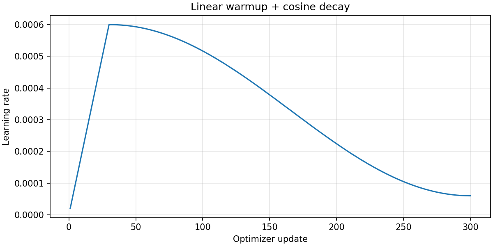

# Hafta 11 — eğitim ve hızlandırma raporu

Bu rapor yalnızca aynı klasördeki ölçüm dosyalarını özetler.

Weight tying: 50.257 × 768 = **38.597.376** parametre tasarrufu. Bağlı model 124.439.808; bağımsız model 163.037.184 parametre içerir. 50.304 vocab ile bağlı model 124.475.904 parametredir.

Başlangıç: matrislerde std=0.02; her bloktaki iki residual çıkış projeksiyonunda std=0.02/√(2L). Toplanan katkıların varyansı derinlikle büyümesin diye her katkının ölçeğini küçültüyoruz. Bu bir başlangıç yaklaşımıdır; dalların bağımsız olduğunu garanti etmez.

Gradient accumulation: eşit sayıda token içeren K mikro batch'in ortalama loss'unu K'ya bölüyoruz. Böylece toplam gradient, birleşik batch'in ortalama loss gradient'ine eşit olur. Clipping ve AdamW bir kez uygulanır; FP16'da önce unscale edilir.

Donanım: `NVIDIA L4`; küçük model kontrolü: **False**.

B,T=[2, 128]; warmup=5; ölçülen adım=20. Süre: veri aktarımı, forward, backward, clipping ve optimizer dahil; derleme/warmup hariç.

| Aşama | ms/adım (medyan) | token/s | Önceki ölçüme göre hız | Durum |
|---|---:|---:|---:|---|
| baseline | 53.750 | 4762.8 | 1.000× | ölçüldü |
| tf32 | 53.043 | 4826.3 | 1.013× | ölçüldü |
| mixed_precision | 59.097 | 4331.9 | 0.898× | ölçüldü |
| compile | 36.790 | 6958.4 | 1.606× | ölçüldü |
| flash_attention | 36.171 | 7077.4 | 1.017× | ölçüldü |
| padded_vocab | 36.227 | 7066.6 | 0.998× | ölçüldü |

Aşamalar birikimlidir. Atlanan/başarısız bir aşama sonraki ayara eklenmez. Padding, tokenizer'ı değiştirmez; softmax'a ek sınıflar katar, bu yüzden loss tam olarak aynı problem değildir.

En yüksek artımlı hız oranı: **compile (1.606×)**. 1'in altındaki oran yavaşlama demektir; tek koşu belirsizliğini gidermez.

En az iki GPU iyileştirme ölçümü şartı: **sağlandı**.

Eğitim durumu: **complete**; küçük model kontrolü: **False**; donanım: `NVIDIA L4`.

AdamW: β=(0.9,0.95), ε=1e-8, decay=0.1; decay uygulanan parametre: **124,354,560** (50 matris). Decay dışı: 121,344.

B,T=2,128; etkin batch: **1024 token**; accumulation=4. Başarılı optimizer güncellemesi: 300. Tam veri turu: 596.

Her adımın loss, clipping öncesi norm, LR, süre ve token/s değeri `training.json` dosyasındadır. FP16 atlanan güncellemeleri ayrıca kaydedilir.

Bu haftaki demo metni eğitim hattını gösterir. Ayrılmış validation verisi ve genelleme değerlendirmesi gelecek haftanın kapsamıdır. Küçük CPU koşuları 124M GPU ödevinin tamamlandığı anlamına gelmez.

Ek görev: DDP/Türkçe tokenizer eğitim karşılaştırması **yapılmadı**. Farklı tokenizer loss'ları doğrudan kıyaslanmaz; aynı ayrılmış metindeki toplam NLL / (ln(2) × UTF-8 byte sayısı) ile bits/byte ölçülebilir. Eşit süre için işlenen byte ve corpus turu da kaydedilmelidir.
