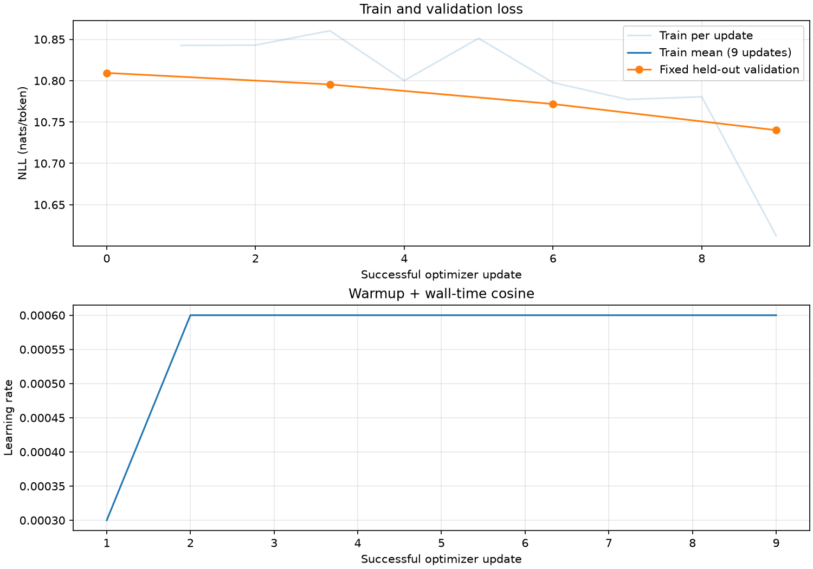

# Hafta 12 — gerçek veri, eğitim ve HellaSwag

Eğitim: **complete**; küçük model kontrolü: **True**; donanım: `Intel64 Family 6 Model 141 Stepping 1, GenuineIntel`.

Model: 1,639,296 parametre, sıfırdan rastgele başlangıç. B=1, T=16, accumulation=2; etkin batch 32 token.

Başarılı güncelleme: **9**; atlanan güncelleme: 0. Görülen eğitim token'ı: **288** (tekrarlar dahil). Duvar süresi: **0.02 dakika**. Update süresine göre token/s: **633.8**. Tüm duvar süresine göre token/s: **289.0**.

Son train loss: **10.612459182739258** nats/token (son güncellemenin mikro batch ortalaması). İlk/son validation loss: **10.80940 → 10.74019**. Her kontrolde aynı ilk 32 validation token'ı ölçüldü.

Hazırlanan veri: train **256 token / 2 shard**, val **128 token / 1 shard**. GPT-2 tokenizer, uint16 NPY; belge sınırlarında EOT. Train/val belgeleri ayrıdır, aynı metnin birebir tekrarları çıkarılır. Yakın kopya temizliği veya HellaSwag kontaminasyon taraması yapılmadı.



## Aynı prompt ve örnekleme ayarlarıyla gelişim

Adım 0 (seed=42, temperature=0.8, top-k=50):

```text
The children walked into the alcoholscape Isa…) format bagsShock condo
```

Adım 6 (seed=42, temperature=0.8, top-k=50):

```text
The children walked into theDieBrexit111mallow Moe){ strongestBenz
```

Adım 9 (seed=42, temperature=0.8, top-k=50):

```text
The children walked into the intriguing fallouthidedesigned holds dizzologic901
```

Örnekleri incelerken başlangıçtaki parçalı token'lardan kelime/cümle düzenine geçiş olup olmadığına bak. Düşen loss tek başına tutarlı veya doğru içerik üretildiğini kanıtlamaz; burada yalnız kaydedilmiş örnekler vardır.

## HellaSwag karşılaştırması

Rastgele, eşit olasılıklı dört seçenek tahmininin beklenen doğruluğu **%25**. Ana ölçüt yalnız devam token'ları üzerinden ortalama NLL (acc_norm). Toplam NLL doğruluğu da kaydedilir. İki modelde ortak 50.257 vocab, FP32 ve TF32 kapalıdır.

| Model | Tamamlanan örnek | Doğru (normalize) | acc_norm | acc (toplam NLL) |
|---|---:|---:|---:|---:|
| own | — | — | bekliyor | — |
| openai | — | — | bekliyor | — |

Ek Türkçe eğitim: **bu koşuda yapılmadı**. Türkçe model için ayrılmış Türkçe metinde loss/bits-per-byte, Türkçe görevler ve insan değerlendirmesi kullanılır. İngilizce HellaSwag tek başına Türkçe kalitesini ölçmez.

Kaynaklar: [FineWeb-Edu](https://huggingface.co/datasets/HuggingFaceFW/fineweb-edu), [HellaSwag](https://huggingface.co/datasets/Rowan/hellaswag), [Karpathy](https://www.youtube.com/watch?v=l8pRSuU81PU&t=11421s).
