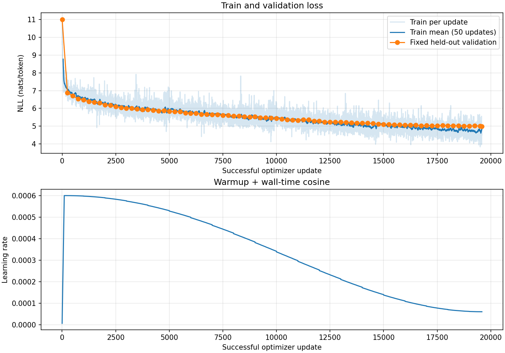

# Hafta 12 — gerçek veri, eğitim ve HellaSwag

Eğitim: **complete**; küçük model kontrolü: **False**; donanım: `NVIDIA L4`.

Model: 124,475,904 parametre, sıfırdan rastgele başlangıç. B=4, T=256, accumulation=4; etkin batch 4,096 token.

Başarılı güncelleme: **19,586**; atlanan güncelleme: 0. Görülen eğitim token'ı: **80,224,256** (tekrarlar dahil). Duvar süresi: **60.20 dakika**. Update süresine göre token/s: **26,215.9**. Tüm duvar süresine göre token/s: **22,208.7**.

Son train loss: **4.742306709289551** nats/token (son güncellemenin mikro batch ortalaması). İlk/son validation loss: **11.01339 → 4.98497**. Her kontrolde aynı ilk 32,768 validation token'ı ölçüldü.

Hazırlanan veri: train **20,000,000 token / 20 shard**, val **131,072 token / 1 shard**. GPT-2 tokenizer, uint16 NPY; belge sınırlarında EOT. Train/val belgeleri ayrıdır, aynı metnin birebir tekrarları çıkarılır. Yakın kopya temizliği veya HellaSwag kontaminasyon taraması yapılmadı.



## Aynı prompt ve örnekleme ayarlarıyla gelişim

Adım 0 (seed=42, temperature=0.8, top-k=50):

```text
The children walked into theElfElf Lorork tomatoes meager maths572ki settling considers ABS Craig BangkokFollowing cryingUsing 1898 Darwin Oath Oath emits emits Strategic Printed Fletcher Harper mapECA hatewatdylib Its Soldier BowlingYP Photo faceutical monkey contracts emitsiversity challeng contactingviraceuticaloon switches guessesifter gauge socioMale tiss lush Eugene scrolling覚醒1200 incumb Indo Palm 118
```

Adım 10000 (seed=42, temperature=0.8, top-k=50):

```text
The children walked into the eye, in the center of the head of the head of the blood, where they are. This was a small body in the heart of the heart, on the eye, and that’s just a very good idea, what is the case?
The reason for this is this: What do the child think
```

Adım 19586 (seed=42, temperature=0.8, top-k=50):

```text
The children walked into the way, which is called the “world” (and their voice of the world). When a person is called to be the person, he does not see anything about his or her. This is not something that is a common one. The person who is a person who is not a friend. And you will
```

Örnekleri incelerken başlangıçtaki parçalı token'lardan kelime/cümle düzenine geçiş olup olmadığına bak. Düşen loss tek başına tutarlı veya doğru içerik üretildiğini kanıtlamaz; burada yalnız kaydedilmiş örnekler vardır.

## HellaSwag karşılaştırması

Rastgele, eşit olasılıklı dört seçenek tahmininin beklenen doğruluğu **%25**. Ana ölçüt yalnız devam token'ları üzerinden ortalama NLL (acc_norm). Toplam NLL doğruluğu da kaydedilir. İki modelde ortak 50.257 vocab, FP32 ve TF32 kapalıdır.

| Model | Tamamlanan örnek | Doğru (normalize) | acc_norm | acc (toplam NLL) |
|---|---:|---:|---:|---:|
| own | 1000 (complete) | 276 | 27.60% | 29.40% |
| openai | 1000 (complete) | 336 | 33.60% | 33.50% |

Aynı 1000 örnekte OpenAI − kendi modelimiz farkı: **+6.00 yüzde puan**. Bu kısa eğitimin veri miktarı, güncelleme sayısı ve metin dağılımı OpenAI'ın ön eğitiminden farklıdır. Farkı yalnız mimariye veya tek bir hiperparametreye bağlayamayız; bu deney nedenleri tek tek ayırmıyor.

Örnek sayısı sınırlı olduğundan örneklem belirsizliği vardır. Her modelin %95 Wilson aralığı ve örnek bazındaki tahminleri JSON'dadır; bu sonuçlar farklı HellaSwag ön işleme yöntemleriyle doğrudan kıyaslanmamalıdır.


Ek Türkçe eğitim: **bu koşuda yapılmadı**. Türkçe model için ayrılmış Türkçe metinde loss/bits-per-byte, Türkçe görevler ve insan değerlendirmesi kullanılır. İngilizce HellaSwag tek başına Türkçe kalitesini ölçmez.

Kaynaklar: [FineWeb-Edu](https://huggingface.co/datasets/HuggingFaceFW/fineweb-edu), [HellaSwag](https://huggingface.co/datasets/Rowan/hellaswag), [Karpathy](https://www.youtube.com/watch?v=l8pRSuU81PU&t=11421s).
